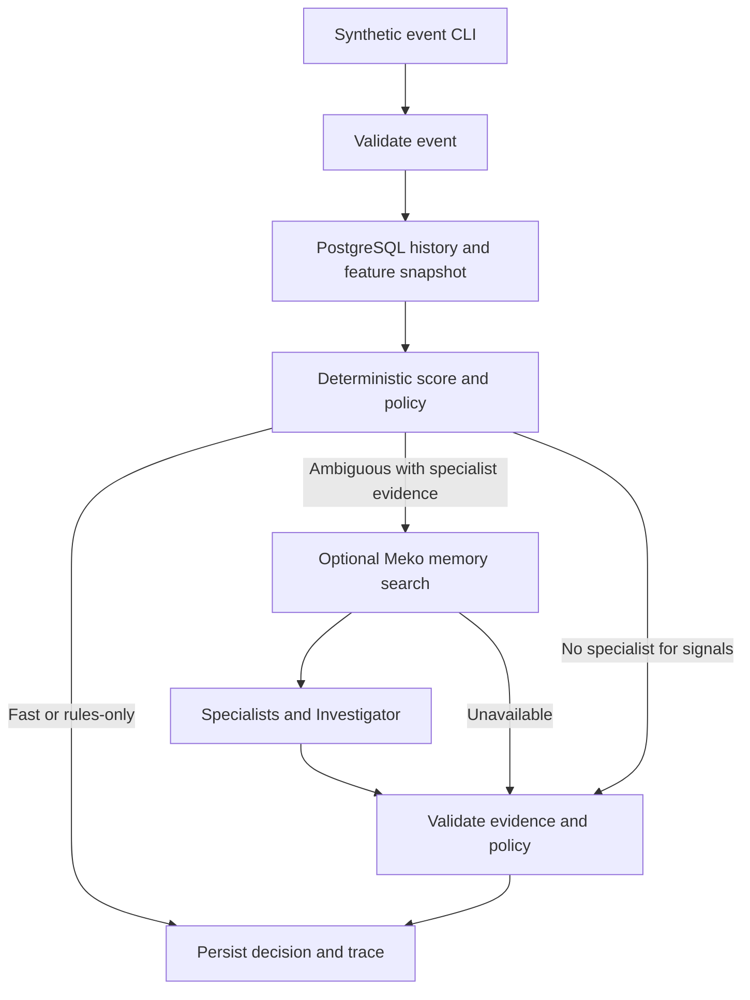

# Architecture

Express is a local modular monolith. TypeScript and Zod define the ingress and agent contracts. PostgreSQL provides indexed history, transactions and durable case records. Compose provides one database service. The simulator is a separate CLI client with its own ground truth.

The fast routes need no external calls. The Behaviour/Login and Transaction specialists receive separate structured features and evidence IDs. They have no tools and their assessments are advisory. The hosted Meko adapter returns bounded search results. The verified fingerprint registry checks their provenance and status before reuse. [Meko MCP reference](https://docs.mekodata.ai/reference/mcp-server/)

Database transactions own validation of event identity and state transitions. Remote calls run after the pending case transaction commits. A database lease fences writes to the decision if an investigation is retried after an interrupted request. Recovery currently uses re-posting the same event after lease expiry.

The analyst workspace in `web/` is a React and Vite client of the same API. It uses read-only routes from `src/workspace.ts`: overview, case lists, session context, patterns, playbooks and a server-sent-event stream that polls PostgreSQL. Writes go through the existing feedback and revoke routes. `npm run build` in `web/` produces static files, which the API serves when present. Institution-wide identity, internet deployment and access controls are outside the local Phase 1 boundary.

## Collective-learning slice

- Behaviour/Login interprets timing and login evidence. Transaction examines amount, velocity and payee evidence. Each applicable specialist requests bounded context from its own attributable Meko call. Provisional matches remain metadata. The Investigator receives validated specialist assessments and summarizes disagreement and missing corroboration. The deterministic policy stays authoritative.
- Accepted specialist evidence can enqueue provisional observations for the risk pack in the same transaction as the final case trace. Only explicit analyst confirmation backed by eligible source evidence queues a generalized fingerprint for the confirmed pack. Application memory carries a format version and stable publication ID. PostgreSQL records identity, delivery state, trusted provenance and supersession alongside the original case.
- A worker uses a claim lease and a single create intent. It first publishes using the live Meko write contract. It verifies acknowledged writes by exact remote ID and document. When no ID was returned, it looks for the exact publication marker and document in Meko search. Published means the remote document was verified. Ranked discovery remains a separate property. A crash or an ambiguous failure after claim can only move into reconciliation reads. This prioritizes duplicate prevention when the provider lacks an idempotent write.
- Transaction may skip a fresh Behaviour/Login review only after receiving a matching real Meko record tied to a published, active, recent fingerprint and a different source account. It rejects mismatched conditions and superseded records. A legitimate correction supersedes the old version immediately in the app and queues a stricter version. Local revocation can retire an active confirmed entry with a durable timestamp and reason. Both checks exclude retired records even when hosted search returns them. Earlier traces remain immutable. Reuse modifies the investigation work and provenance, while the policy verdict stays unchanged.
- The verified-pattern policy is the one path where memory changes an action. Inside the ingestion transaction it compares the current session with active, read-back confirmed session patterns from other accounts, using local tables only. In `enforce` a match blocks. Agents and provisional observations cannot trigger it. See [Decision flow](DECISION_FLOW.md#verified-pattern-policy).
- The fresh UUID used by read-only memory search is a request trace identifier. Publication passes the ID returned by the Meko conversation creation call. Persistent analyst conversations would need a durable conversation mapping and proven message replay across requests. Those were not verified by the initial conversation probes.

The demo uses a unique schema per execution and only asks Meko for confirmed document IDs published by that schema. It still validates returned remote content, conditions and version. This keeps a repeated seed’s previous memories out of the comparison. Ordinary cases retain semantic retrieval. Provisional search results remain trace metadata and cannot affect the policy or trigger reuse.

## Extended investigation profile

The normal collective profile routes Behaviour/Login, Device/IP, Transaction and Graph only when their respective evidence is present in a case that needs review. The Investigator receives their validated evidence IDs and recommendations, notes conflicts and missing roles, and remains advisory. Rules still determine every action. Hosted Meko reads can overlap; local model calls are serial within a case. The evaluator submits cases serially. Model capacity under concurrent API traffic remains unmeasured.

The feature snapshot excludes events after the earlier of the incoming event time and the database statement time. Device/IP uses historical device counts, failed authentication on the unfamiliar device, session transitions, geometric travel calculations and [simulated network telemetry](DECISION_FLOW.md). Device findings and graph evidence add zero policy points. [Graph design and timings](GRAPH.md) describes the indexed, bounded PostgreSQL queries, future-time exclusions, path provenance and corroboration requirements. A graph query failure preserves the deterministic case decision and is recorded in the trace.

The API commits the case and accepted specialist observations to PostgreSQL together. The worker publishes and verifies them outside the request. On a subsequent review, the selected recipient can fetch up to two earlier observations by acknowledged ID from the risk pack. PostgreSQL admits only previously verified observations on the same synthetic account, from another role, inside the prior 30 event minutes and available before the target case started. The remote content must match the registry document before any model sees its evidence IDs. The receiving specialist and Investigator get provisional context alongside independently computed current evidence. An outage or publication delay leaves ordinary local policy intact. Publication follows the source case decision, so immediate arrivals can precede memory visibility. Local inference happens before an investigated HTTP response completes.

Ranked confirmed discovery is separate. The normal path builds the query from present evidence, sends no expected memory ID, and checks publication provenance, revocation, supersession, prior availability and applicability. The historical A/B/C/D demo keeps its explicit isolated legacy profile and exact-ID proof. Neither mode treats model confidence or retrieval rank as fraud proof.
